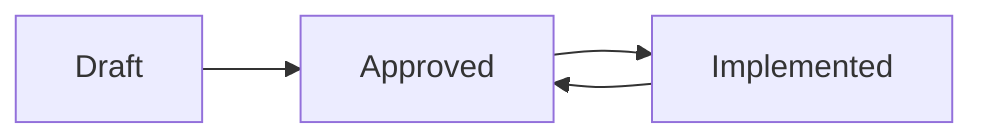

# Specs

Specs are versioned code. They live in this folder, change through commits, and **every behavior
change starts with a spec change**. Code and tests implement specs; they never lead them.

## Layout

| File                               | Purpose                                                   |
| ---------------------------------- | --------------------------------------------------------- |
| [constitution.md](constitution.md) | Non-negotiable principles: stack, quality bar, scope      |
| [api-contract.md](api-contract.md) | Verified JSONPlaceholder contract, schemas, fixtures      |
| [architecture.md](architecture.md) | Folder structure, data flow, state and error strategy     |
| `features/*.md`                    | One spec per feature, with requirement IDs and tests      |
| [plan.md](plan.md)                 | Ordered implementation plan                               |
| [tasks.md](tasks.md)               | Atomic tasks, each mapped to requirement IDs and a commit |

## Feature spec template

Every file in `features/` has these sections, in this order:

1. **Context**: why the feature exists, in two or three sentences.
2. **User stories**: `As a <role>, I want <goal>, so that <benefit>`.
3. **Functional requirements**: one line each, with a stable ID.
4. **Acceptance criteria**: Given/When/Then, each tagged with the requirement IDs it proves.
5. **Edge cases**.
6. **Non-functional requirements**: accessibility, performance.
7. **Out of scope**.
8. **Traceability**: requirement ID to test file and test name.

Keep each spec short and single-purpose. Behavior shared by several features lives in one place
(for example [async-states](features/async-states.md)) and is referenced, not repeated.

## Requirement IDs

| Prefix | Spec                                     |
| ------ | ---------------------------------------- |
| `AS-`  | [async-states](features/async-states.md) |
| `UL-`  | [users-list](features/users-list.md)     |
| `UP-`  | [user-posts](features/user-posts.md)     |
| `CP-`  | [create-post](features/create-post.md)   |
| `API-` | [api-contract](api-contract.md)          |

- IDs are two digits (`UL-01`) and **never reused or renumbered**. A dropped requirement stays in
  the table, struck through, with the reason.
- Test names start with the ID they prove, for example
  `it('UL-03 matches names regardless of accents', ...)`. That keeps traceability greppable:
  `rg "UL-03" src e2e`.

## Lifecycle

- **Draft**: being written. Nothing may be implemented against it.
- **Approved**: reviewed by a human. Tests may be written against it.
- **Implemented**: every requirement has at least one passing test in the traceability table.
- Changing an implemented requirement moves the spec back to **Approved** until the tests and code
  catch up.

## Workflow

1. Update the spec (its own `docs(spec): ...` commit).
2. Write failing tests named after the requirement IDs (`test(<scope>): ...`).
3. Implement the minimum to pass (`feat(<scope>): ...`).
4. Refactor if there is a real improvement (`refactor(<scope>): ...`).
5. Fill in the traceability table and set the spec status.

If implementation reveals the spec is wrong, stop, fix the spec first, then continue.
