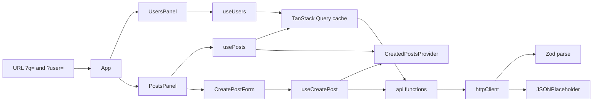

# Architecture

- **Status:** Approved
- Proportional to a 3-hour assessment: one page, two features, a handful of shared primitives.

## Folder structure

```text
src/
  app/                    App shell, providers, QueryClient, error boundary, layout
  features/
    users/
      api/                getUsers()
      components/         UsersPanel, UserSearch, UserList, UserListItem
      hooks/              useUsers, useUserSearch
      schemas/            userSchema, usersSchema
      __tests__/
    posts/
      api/                getPostsByUser(), createPost()
      components/         PostsPanel, PostList, PostCard, CreatePostForm
      hooks/              usePosts, useCreatePost
      schemas/            postSchema, createPostFormSchema
      state/              CreatedPostsProvider (locally created posts)
      __tests__/
  shared/
    api/                  httpClient, ApiError, API_BASE_URL
    lib/                  normalizeText, useDebouncedValue, useSearchParam
    ui/                   Button, Avatar, Skeleton, ErrorState, EmptyState, Badge
  test/                   setup, MSW server and handlers, fixtures, render helpers
```

- Features never import from each other's internals. The app layer composes them.
- `shared/` has no feature knowledge.
- Tests live next to the feature in `__tests__/`. Pure helpers in `shared/` keep a sibling
  `*.test.ts`.

## Data flow



## State strategy

| State                         | Owner                                    | Why                                                      |
| ----------------------------- | ---------------------------------------- | -------------------------------------------------------- |
| Users, posts from the server  | TanStack Query                           | Caching, cancellation, retries, loading and error status |
| Search text and selected user | URL (`?q=`, `?user=`)                    | Shareable, survives reload, single source of truth       |
| Search input while typing     | Local `useState`, debounced into the URL | Instant typing without spamming history or filtering     |
| Locally created posts         | `CreatedPostsProvider` (React context)   | Client-only data the server never stores, see below      |
| Form fields and validation    | React Hook Form                          | Uncontrolled inputs, schema validation, touched state    |

### URL state

There's no router dependency for two query parameters. `useSearchParam(name)` reads
`window.location.search` through `useSyncExternalStore` and writes with `history.replaceState`.
`popstate` keeps it in sync with back and forward navigation.

- `q` is written after the debounce, and removed when empty.
- `user` is written on selection and removed on "Back to users". Non-numeric values are ignored.

### Server state (TanStack Query)

- Query keys come from a factory per feature:
  - `usersKeys.all = ['users']`
  - `postsKeys.byUser(userId) = ['posts', { userId }]`
- `staleTime: 5 min`. The API sends `Cache-Control: max-age=43200` and the data never changes, so
  revisiting a user shows cached posts instantly with no refetch. Five minutes rather than
  infinity keeps the behavior conventional.
- `refetchOnWindowFocus: false`. The data is static, and focus refetches would only add flicker.
- Retry: `retry(failureCount, error)` returns `false` for `ApiError` of kind `http` with a 4xx
  status, or kind `parse`, and allows **at most 2 retries** for `network` and 5xx. Mutations never
  retry because `POST` is not idempotent.
- Tests use a fresh `QueryClient` per test with `retry: false`, except the retry-policy tests.

### Created posts

`POST /posts` always returns `id: 101` and persists nothing
([api-contract](api-contract.md#api-03-post-posts)). Therefore:

- **Identity:** each created post gets `clientId = crypto.randomUUID()`. List keys are namespaced:
  `server-<id>` for API posts and `local-<uuid>` for created posts, so collisions are impossible
  both with server ids (1..100) and with each other. The server's `id` is parsed for validation
  and then ignored.
- **Storage:** `CreatedPostsProvider` holds `Record<userId, CreatedPost[]>` with `useReducer`
  above the panels. Created posts are client-only data, so they stay out of the server-state
  cache. Refetches, invalidations or cache garbage collection can therefore never drop them, and
  no fake `queryFn` is needed.
- **Merge:** `usePosts(userId)` returns created posts for that user first (newest first), followed
  by the server posts in API order. This is a pure function of both sources, derived at render,
  never synced into state.
- **Lifetime:** created posts survive switching between users. They are lost on a full reload,
  which matches the API's fake persistence and is documented as a known limitation.
- **Attribution:** the `userId` captured at submit time owns the post, even if the user switches
  while the request is in flight.

## API client

`httpClient` is the only place that calls `fetch`.

```ts
request<T>(path: string, schema: ZodType<T>, init?: { method?: 'GET' | 'POST'; body?: unknown; signal?: AbortSignal }): Promise<T>
```

- Builds `https://jsonplaceholder.typicode.com${path}` from `API_BASE_URL`.
- Sends `Accept: application/json`. With a body, it also sends
  `Content-Type: application/json; charset=UTF-8`, which the API requires.
- Passes `signal` to `fetch`. An `AbortError` is **re-thrown untouched** so TanStack Query treats
  it as a cancellation, not a failure.
- Parses JSON only for `2xx` responses. Error bodies can be HTML, so they are never parsed.
- Validates with the given Zod schema.

### Error taxonomy

`ApiError extends Error` with a discriminated `kind`:

| Kind      | When                                               | Extra    | User message                                                         |
| --------- | -------------------------------------------------- | -------- | -------------------------------------------------------------------- |
| `network` | `fetch` rejects (offline, DNS, CORS), not an abort | `cause`  | "We couldn't reach the server. Check your connection and try again." |
| `http`    | Response status outside `2xx`                      | `status` | "The server responded with an error (status 503). Please try again." |
| `parse`   | Invalid JSON, or the payload fails Zod validation  | `cause`  | "We received unexpected data from the server. Please try again."     |

`getErrorMessage(error: unknown)` maps any error to a user message. Unknown errors fall back to
"Something went wrong. Please try again." Every error UI offers a Retry action
([async-states](features/async-states.md)).

### Render errors

A small class-based `AppErrorBoundary` at the app root catches unexpected render errors. It shows
a friendly message with a "Reload page" link and logs to `console.error`. Async errors never reach it
because they are handled as query state.

## Performance

- No `React.lazy` or code splitting. The app is one small screen, and a split would add a loading
  state without a measurable gain.
- Memoization only when a measured problem exists. Filtering 10 users per keystroke is trivial,
  and the debounce exists for URL churn, not CPU.
