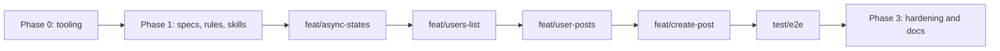

# Implementation plan

- **Status:** Approved
- Order follows dependencies: shared primitives first, then each feature end to end.
- Each feature runs on its own short-lived branch, merged into `main` with `--no-ff`.

## Steps

| Step | Branch              | Specs                | Outcome                                                                                |
| ---- | ------------------- | -------------------- | -------------------------------------------------------------------------------------- |
| 1    | `feat/async-states` | AS-01..07            | `httpClient`, `ApiError`, `getErrorMessage`, `createQueryClient` with the retry policy |
| 2    | `feat/async-states` | AS-08..11            | Design tokens, `Skeleton`, `ErrorState`, `EmptyState`, `Button`, `AppErrorBoundary`    |
| 3    | `feat/users-list`   | UL-03, UL-04         | `normalizeText`, `useDebouncedValue`, `useSearchParam`                                 |
| 4    | `feat/users-list`   | UL-01, 02, 05..09    | Users API and schema, `useUsers`, `UsersPanel` with search, empty, selection           |
| 5    | `feat/user-posts`   | UP-01..05, UP-07..09 | Posts API and schema, `usePosts`, `PostsPanel`, master-detail layout                   |
| 6    | `feat/user-posts`   | UP-06                | Cancellation verified through the App integration test                                 |
| 7    | `feat/create-post`  | CP-02, CP-03         | `createPostFormSchema`                                                                 |
| 8    | `feat/create-post`  | CP-01, 04..11        | `CreatedPostsProvider`, `useCreatePost`, `CreatePostForm`, merge into `usePosts`       |
| 9    | `test/e2e`          | Journeys and axe     | Playwright specs with `page.route` fixtures, plus the axe check                        |
| 10   | `docs/final`        | All                  | Full pipeline, bundle and a11y review, TSDoc, README, AI log                           |

Every step follows the [TDD cycle](README.md#workflow): `test(...)` red commit, `feat(...)` green
commit, an optional `refactor(...)`, then the traceability update in the spec.

## Time budget

The total time box is 3 hours from the start (10:26). Phases 0 and 1 used about 1.5 h, mostly on
version verification, slow package downloads and API verification. The remaining budget is about
1.5 h for steps 1 to 10.

If a step overruns, cut in this order and document the cut in the README:

1. UP-08 mobile focus management (keep the layout, drop the focus move).
2. UP-09 dedicated cache test (the behavior still comes from `staleTime`).
3. e2e journeys reduced to "search and select" plus "create post" with axe.
4. Refactor commits, only when there is a real improvement.

Never cut: the TDD order, the five assessment requirements, error and retry states, validation, or
the README and AI log.
